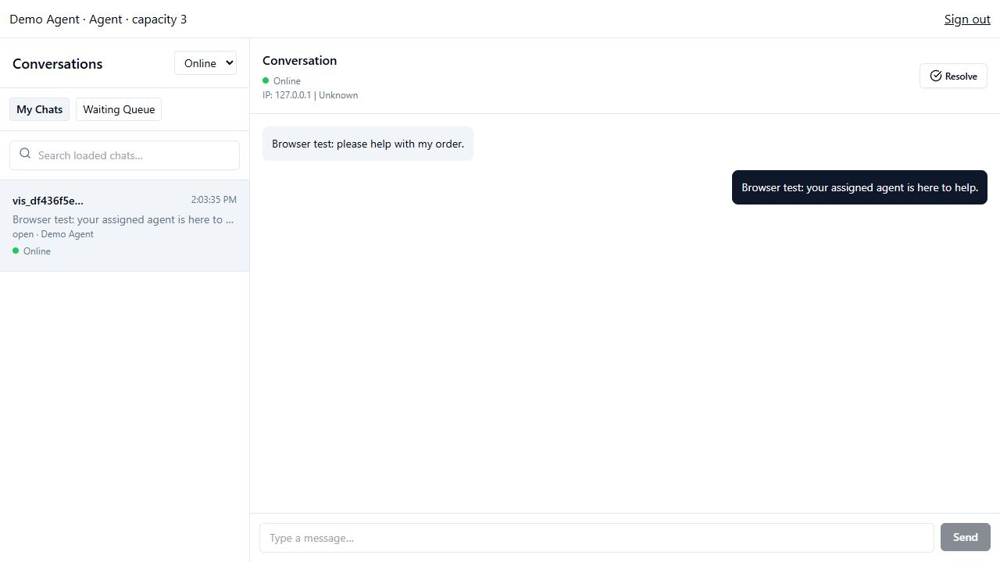

# Priority 1: super admin and agent-owned chats

The application now separates `super_admin`, `agent`, and visitor identities.
Agents can handle multiple active conversations, with a configurable capacity
from 1 to 100 (default 5). Each conversation has at most one assigned agent.
Capacity is released when a conversation is resolved or requeued on deactivation.

## Install or upgrade

For a new database, initialize `backend/schema.sql`. For an existing database,
back up first, stop the old backend, and run from the repository root:

```powershell
npm.cmd --prefix backend run db:migrate
npm.cmd --prefix backend run admin:bootstrap -- --name "Support Owner" --email "owner@example.com"
```

Use `npm` instead of `npm.cmd` on Linux/macOS. Run these commands using the
intended backend environment; the application never applies migrations at startup.
The migration runner applies migrations in filename order; both current SQL files
are safe to rerun. Migration 002:

- Preserves existing messages, accounts, and conversation owners.
- Adds roles, activation state, capacity, session versions, and setup credentials.
- Normalizes email addresses and enforces case-insensitive uniqueness. It aborts
  if existing addresses collide after trimming/lowercasing; resolve those accounts
  explicitly before retrying.
- Adds assignment history for acceptance/deactivation and an open-owner index.

Existing accounts retain the `agent` role. The account named "Admin" in an older
installation is not automatically privileged. Supply a new unique email for the
initial super admin. Existing staff JWTs lack a session version and must sign in
again. Visitor tokens continue working.

The bootstrap command requires direct database access and prints a single-use
setup path. Open it on the frontend host, for example:

```text
http://localhost:5173/set-password#token=THE_PRINTED_TOKEN
```

Use HTTPS on a hosted installation. Set a password with at least 12 characters
and at most 72 UTF-8 bytes, then sign in at `/login`. The initial provisioning
transaction is serialized: simultaneous runs cannot create two super admins.
There is no public bootstrap endpoint and ordinary agents cannot create accounts
or alter roles.

If the initial setup link is lost or expires before completion:

```powershell
npm.cmd --prefix backend run admin:bootstrap -- --reissue --email "owner@example.com"
```

This replaces the token for the unfinished initial super-admin setup only. It
does not reset a super admin whose password has already been set. Recovery for a
completed super-admin account requires a separately authorized database-operator
procedure; there is no public admin recovery shortcut.

Start matching frontend/backend versions after migration. No migration or
bootstrap command is executed against your application database by the test suite.

## Super-admin workflow

1. Sign in and open **Manage agents** (`/agents`).
2. Enter a name, email, and maximum active chats. Emails are trimmed/lowercased.
3. Create the invitation and deliver the displayed setup link privately to that
   agent. Email delivery is manual; no email provider is configured.
4. Use **Edit** to change the name, email, or capacity. Capacity cannot be lowered
   below the current number of active chats.
5. Use **Reset password** to issue a replacement setup link. Existing sessions
   and older setup links immediately become invalid. The account cannot log in
   until password setup succeeds. Existing assignments are retained.
6. Use **Deactivate** to invalidate access, disconnect all tabs, and return every
   open assigned chat to the waiting queue. Resolved ownership and historical
   sender IDs remain; `conversation_assignments` records released owners.
7. **Reactivate** allows new login but does not restore old sessions or reassign
   released chats. If password setup is pending, it must still be completed.

Invitations/reset links expire after 24 hours, are consumed atomically once, and
are stored only as SHA-256 hashes. Raw tokens are returned only when issued and
are not included in account listings. The UI puts them in a URL fragment, which
is not sent in HTTP requests. Treat the full link as a credential. It is removed
from the address bar after a successful password change.

**Inbox oversight** provides All Chats and Waiting Queue. Super admins can read,
reply to, and resolve any conversation, including unassigned chats. They do not
claim queue entries or count as online support agents. Messages from a super
admin retain their actual account ID in storage and use the public `agent`
message type in the visitor UI.

## Agent workflow and permissions

1. Complete the invitation and sign in.
2. Connect to the support server and set availability to **Online**.
3. Open **Waiting Queue**. Agents see visitor identifiers, waiting time, and
   presence; message previews, IP addresses, and location are redacted.
4. Choose **Accept Chat**. The server locks the account and conversation,
   rechecks activation/session, ownership, capacity, and online presence, then
   assigns the conversation in the same transaction as its history record.
5. Open **My Chats** to read, reply, or resolve. Unrelated agents cannot access
   these messages through HTTP, socket history, send, typing, or server events.

Concurrent claims produce one owner. Concurrent accepts by the same agent,
including separate tabs, cannot exceed capacity. Retrying an acceptance already
owned by that same agent is idempotent. A failed claim reports a stable conflict
code; refresh the queue to see current availability.

Going **Offline** prevents new acceptance but permits finishing already owned
work. Losing a connection also prevents new acceptance. Assignments survive
disconnects and backend restarts; automatic disconnect-based requeueing and
transfers are Priority 2 work. A disabled account cannot accept or continue work.

## Transport additions

All protected endpoints use `Authorization: Bearer <token>` and read current
account state. Account roles and session versions are verified against PostgreSQL,
not trusted from browser state. Public responses omit password/token hashes.

- `GET /api/auth/me`: current public account and active-chat count.
- `POST /api/auth/set-password`: `{ token, password }`; consumes an unexpired
  setup credential and revokes previous sessions. This is credential setup,
  not public account registration.
- `GET /api/agents?limit=50&before=<id>`: super-admin-only, bounded account list.
  The continuation is the last returned UUID, ordered by UUID ascending.
- `POST /api/agents`: `{ name, email, capacity? }`; creates role `agent` and
  returns `{ agent, setupToken, expiresAt }`.
- `PATCH /api/agents/:id`: `{ name, email, capacity }`; edits an ordinary agent.
- `POST /api/agents/:id/status`: `{ active: boolean }`.
- `POST /api/agents/:id/reset-password`: returns `{ setupToken, expiresAt }`.
- `GET /api/conversations?view=mine|queue|all&limit=50&before=<id>`: defaults to
  `mine` for agents and `all` for super admins. `all` is super-admin-only.
- `POST /api/conversations/:id/accept`: assigns an eligible online agent and
  returns `{ id }`. Identity never comes from a request body.

Account management cannot target super-admin accounts or change roles. Account
listings include `is_active`, `pending_setup`, `capacity`, and `active_chats`.
Setup expiry and timestamps cross the API as ISO 8601 UTC strings.

Conversation list ordering is now `(created_at, id)` descending, so message
updates do not move the pagination cursor. `created_at`, `agent_id`, and
`agent_name` are included in each list row. Ownership/capacity mutation conflicts
include `ALREADY_ACCEPTED`, `AT_CAPACITY`, `AGENT_OFFLINE`, `CHAT_UNAVAILABLE`,
and `CAPACITY_IN_USE`. Unauthorized conversation access returns `NOT_FOUND`.

`conversation_update` is now `{}`: it invalidates lists without disclosing chat
IDs. `presence_changed` replaces global visitor online/offline payloads; clients
refetch `visitor_presence` snapshots scoped to owned or queued conversations.
Private message/typing/resolution delivery reauthorizes each receiving staff
socket. Staff never join visitor conversation rooms merely by connecting.

## Verification and limits

```powershell
npm.cmd --prefix backend test
npm.cmd --prefix backend run test:postgres
npm.cmd --prefix frontend run typecheck
npm.cmd --prefix frontend run build
```

The PostgreSQL suite creates a disposable local database and covers bootstrap
races, single-use/expired credentials, normalized emails, role restrictions,
claim races, capacity, offline acceptance, HTTP/socket ownership, event privacy,
password resets, multiple-tab revocation, and deactivation history. It requires a
local PostgreSQL role permitted to create test databases.

Verified on 2026-10-21: 15 backend tests and 11 PostgreSQL tests (including the
parent integration test) passed, along with TypeScript checking and the production
build. A browser smoke check exercised supervisor login/agent-management display,
agent login, redacted queue display, acceptance, bidirectional messaging, and
resolution. It used a disposable PostgreSQL database and a Redis test stub; the
temporary database was removed afterward. The application's existing database
was not migrated or modified by these checks.



The server still supports one backend process. Presence eligibility is local to
that process; horizontal scaling needs coordinated presence and a compatible
delivery strategy. There is no email integration, transfer workflow, full audit
UI, or automated reconnect grace/requeue policy in this release. The assignment
history table records ownership transitions, not a complete security audit trail.
